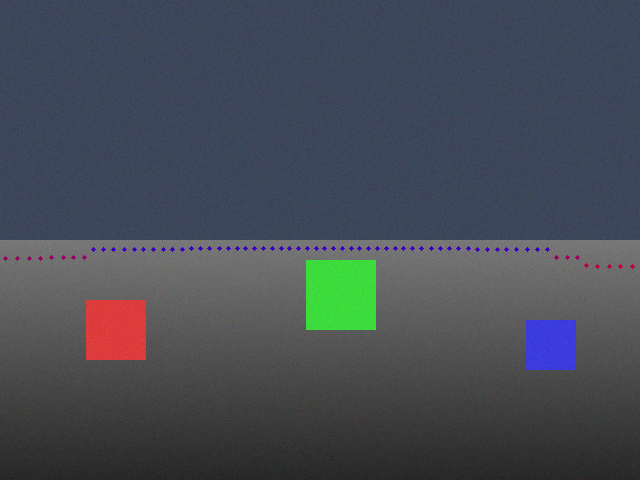
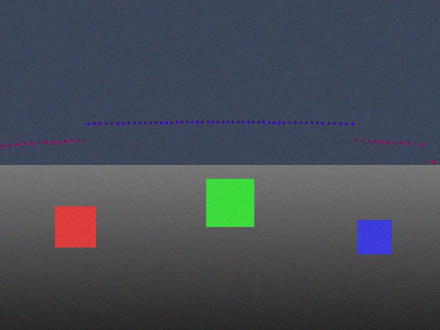

# M1-3 ｜ 时间与坐标：让两个传感器“说到一起去”

本工作区在离线 rosbag 回放中完成：

- 从 `extrinsics.yaml` 读取传感器外参和相机内参；
- 发布 `map → odom → base_link → laser_link/camera_link` 静态 TF；
- 使用 `ApproximateTimeSynchronizer` 同步 `/scan` 和 `/camera/image_raw`；
- 将二维激光点转换到 `camera_link` 和相机光学坐标；
- 使用针孔相机模型计算图像像素；
- 按激光距离从红色到蓝色绘制投影点；
- 发布 `/projection/debug_image`；
- 保存三张不同时刻的投影图。

## 一、目录结构

```text
M1-3/
├── README.md
├── extrinsics.yaml
├── projection_001.png
├── projection_002.png
├── projection_003.png
├── projection_nondefault.png
├── tools/
│   └── make_bag.py
└── src/
    └── m1_projection/
        ├── launch/
        ├── m1_projection/
        │   ├── static_tf_node.py
        │   └── projection_node.py
        ├── resource/
        ├── package.xml
        ├── setup.cfg
        └── setup.py
```

`sample_bag/` 约 95 MiB，已加入 `.gitignore`，不提交到 Git。

## 二、构建

```bash
cd /home/tranc/codex/codex_chat/m0-m6-practice/M1/M1-3
source /opt/ros/humble/setup.bash
colcon build --symlink-install
source install/setup.bash
```

构建结果：

```text
Summary: 1 package finished
```

## 三、生成测试数据

当前使用的数据集由以下命令生成：

```bash
cd /home/tranc/codex/codex_chat/m0-m6-practice/M1/M1-3
source /opt/ros/humble/setup.bash

python3 tools/make_bag.py \
  --frames 40 \
  --out sample_bag \
  --extrinsics extrinsics.yaml
```

数据规模：

```text
bag 大小            95.1 MiB
时长                3.980298758 s
/scan               40 条，约 10 Hz
/camera/image_raw   108 条，约 27 Hz
/camera/camera_info 108 条
```

数据集检查结果：

```text
/scan frame_id               laser_link
激光线数                     180
距离范围                     0.1～8.0 m

/camera/image_raw frame_id   camera_link
图像尺寸                     640×480
编码                         rgb8

CameraInfo K/P/D             与 extrinsics.yaml 一致
```

## 四、运行

每个终端都需要加载环境：

```bash
cd /home/tranc/codex/codex_chat/m0-m6-practice/M1/M1-3
source /opt/ros/humble/setup.bash
source install/setup.bash
```

### 终端 1：静态 TF

```bash
ros2 run m1_projection static_tf_node
```

### 终端 2：投影节点

```bash
ros2 run m1_projection projection_node \
  --ros-args \
  -p use_sim_time:=true \
  -p sync_slop:=0.02 \
  -p queue_size:=50 \
  -p extrinsics_file:=/home/tranc/codex/codex_chat/m0-m6-practice/M1/M1-3/extrinsics.yaml \
  -p output_dir:=/home/tranc/codex/codex_chat/m0-m6-practice/M1/M1-3 \
  -p max_images:=3
```

### 终端 3：回放 bag

```bash
source /opt/ros/humble/setup.bash
ros2 bag play sample_bag --clock
```

## 五、TF 树

`static_tf_node` 从 YAML 读取外参并发布：

```text
map
 └── odom
      └── base_link
           ├── laser_link
           └── camera_link
```

当前默认外参：

```text
base_link → laser_link
xyz = [0.15, 0.00, 0.20]
rpy = [0.00, 0.00, 0.00]

base_link → camera_link
xyz = [0.10, 0.00, 0.30]
rpy = [0.00, 0.00, 0.00]
```

检查命令：

```bash
ros2 topic echo /tf_static --once
ros2 run tf2_ros tf2_echo base_link laser_link
ros2 run tf2_ros tf2_echo base_link camera_link
ros2 run tf2_ros tf2_echo laser_link camera_link
```

实测：

```text
base_link → laser_link
Translation: [0.150, 0.000, 0.200]

base_link → camera_link
Translation: [0.100, 0.000, 0.300]

laser_link → camera_link
Translation: [-0.050, 0.000, 0.100]
```

## 六、时间同步

激光和相机来自独立时间线：

```text
/scan               10 Hz，时间戳抖动约 ±3 ms
/camera/image_raw   27 Hz，时间戳抖动约 ±2 ms
```

两路消息无法使用精确同步，必须使用：

```text
ApproximateTimeSynchronizer
```

当前 bag 的 `slop` 实测：

| `sync_slop` | 配对数 | 时间差中位数 | 最大时间差 |
| :--: | :--: | :--: | :--: |
| 20 ms | 40/40 | 8.276 ms | 18.897 ms |
| 50 ms | 40/40 | 20.047 ms | 44.147 ms |
| 100 ms | 40/40 | 21.288 ms | 46.279 ms |

结论：

- 当前 bag 中 `20 ms` 已能配到全部 40 帧；
- 增大到 `50/100 ms` 没有增加配对数，但时间误差变大；
- 最终选择 `sync_slop=0.02`、`queue_size=50`。

相机帧数多于激光，`ApproximateTimeSynchronizer` 是一对一匹配，因此 108 张图像最多
只会产生 40 个回调配对，其余图像被丢弃。

## 七、坐标和投影计算

每条激光：

```text
theta = angle_min + index * angle_increment
x_laser = range * cos(theta)
y_laser = range * sin(theta)
z_laser = 0
```

应用 TF 后：

```text
p_camera = R_laser_to_camera * p_laser + t_laser_to_camera
```

当前默认外参下：

```text
p_camera = p_laser + [0.05, 0.00, -0.10]
```

相机光学坐标：

```text
X_opt = -Y_camera
Y_opt = -Z_camera
Z_opt =  X_camera
```

针孔投影：

```text
u = fx * X_opt / Z_opt + cx
v = fy * Y_opt / Z_opt + cy
```

有效点必须满足：

```text
range_min <= range <= range_max
Z_opt > 0
0 <= u < image_width
0 <= v < image_height
```

当前相机比激光扫描平面高 `0.10 m`，因此所有点位于图像中心略下方：

```text
v ≈ 240 + 500 * 0.10 / depth
```

距离越近，投影位置越偏下；距离越远，越接近图像中心。

## 八、默认外参实测

最终汇总：

```text
count=40
median_dt_ms=8.276
transform_errors=0
average_points=180.0
average_projected=66.0
saved_images=3
```

第一帧：

```text
valid_points=180
projected_points=66
u=[5.086, 634.912]
v=[248.232, 258.254]
depth=[2.739, 6.074]
```

每帧固定保留约 66 个点，是因为激光视野约 `180°`，明显大于当前约 `65°` 的相机水平视场。

结果图：





三张图片均为：

```text
640×480 RGB PNG
不同时间戳、不同文件哈希
```

## 九、非默认外参验证

为了避免写死默认参数，使用以下数据重新验证：

```bash
python3 tools/make_bag.py \
  --frames 10 \
  --out /tmp/m1_3_alt_bag \
  --extrinsics /tmp/m1_3_alt_extrinsics.yaml \
  --laser-z 0.45 \
  --camera-z 0.75 \
  --camera-pitch-deg 10 \
  --fx 420
```

使用新的 YAML 同时启动静态 TF 和投影节点后：

```text
base_link → laser_link z = 0.45
base_link → camera_link z = 0.75
camera pitch = 10°
fx = 420
```

实测汇总：

```text
count=10
median_dt_ms=8.712
transform_errors=0
average_points=180.0
average_projected=76.0
```

第一帧：

```text
u=[3.186, 631.425]
v=[177.126, 235.297]
depth=[1.825, 6.023]
```

与默认外参结果相比，`v` 从约 `248～258` 明显移动到 `177～235`，证明相机高度和
pitch 确实参与 TF 与投影计算。

结果图：



## 十、`use_sim_time` 对比

### `use_sim_time=true`

节点使用 bag 的 `/clock`：

- ROS timer 随 bag 仿真时间推进；
- bag 回放结束后，仿真时钟停止；
- 一秒汇总 timer 也停止输出；
- 消息同步、TF 查询和投影正常。

### `use_sim_time=false`

实测结果：

```text
同步配对仍为 40
median_dt_ms=8.276
transform_errors=0
average_projected=66.0
```

原因是当前实现使用消息自身的 `header.stamp` 进行同步，并通过时间戳查询静态 TF；
静态 TF 对所有时间有效。因此本次静态场景下，关闭仿真时间没有破坏投影流程。

区别在于：

- `true` 时节点 ROS timer 使用 bag 时间；
- `false` 时节点 ROS timer 使用系统时间；
- `false` 时 bag 回放结束后，汇总 timer 仍会继续打印。

## 十一、其他检查命令

查看调试图：

```bash
ros2 topic echo /projection/debug_image --field header --once
ros2 topic hz /projection/debug_image
```

检查节点：

```bash
ros2 node list
```

预期：

```text
/projection_node
/static_tf_node
```

检查输出图片：

```bash
file projection_001.png
```

预期：

```text
PNG image data, 640 x 480, 8-bit/color RGB
```

## 十二、实际踩坑记录

### 1. bag 话题没有发布者

直接运行：

```bash
ros2 topic echo /scan --once
```

提示话题尚未发布。

原因：bag 是离线数据，必须先运行：

```bash
ros2 bag play sample_bag --clock
```

### 2. 时间戳从 Unix Epoch 开始

`ros2 bag info` 显示：

```text
Jan 1 1970 08:00:00
```

这是 `T0_NS=0` 和本地时区共同造成的显示结果，不是时间戳损坏。

### 3. 激光角度增量存在正常的 float32 误差

存储值：

```text
0.01755079627 rad
```

理论值：

```text
π / 179 ≈ 0.01755079744 rad
```

差值约 `1.17e-9 rad`，属于消息 `float32` 的正常舍入。

### 4. `sync count=40` 后不再增加

bag 只有 40 帧激光，因此最多产生 40 个一对一同步配对。

### 5. 投影点位于图像中心偏下

相机安装在激光扫描平面上方 `0.10 m`。投影纵坐标满足：

```text
v = 240 + 50 / depth
```

因此所有点位于 `v>240`，两侧近处点会比正前方远处点更偏下。

### 6. 节点关闭时出现 rosout 日志错误

测试使用外部超时或按 Ctrl+C 关闭节点时，偶尔出现：

```text
Failed to publish log message to rosout
publisher's context is invalid
```

这是退出阶段日志上下文已经失效造成的清理提示，不影响已经完成的同步、TF 和图像。

## 十三、AI 使用声明

- 静态 TF、时间同步、坐标转换、相机投影和绘图代码结构由 AI 辅助设计；
- 所有代码由本人手动输入，并实际构建和运行；
- 40 帧同步、三张投影图、非默认外参及 `use_sim_time` 两种模式均经过实际命令验证；
- 本 README 使用 AI 辅助整理，命令、数值和结论已按本机实际输出核对。
